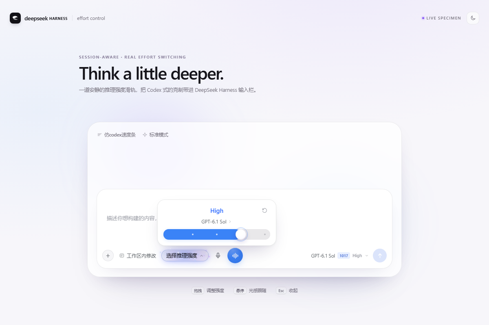
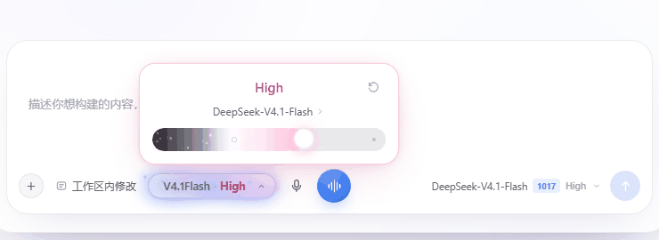
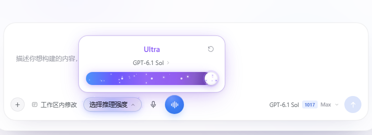
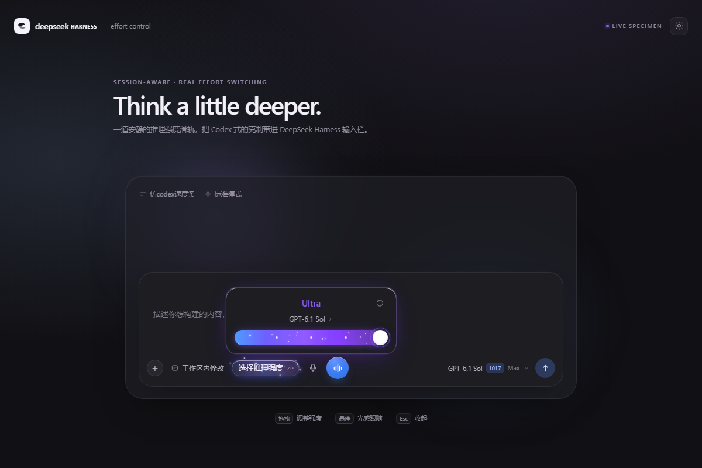
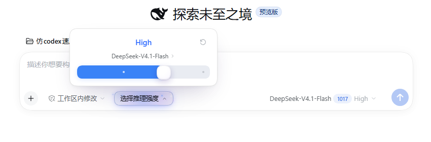
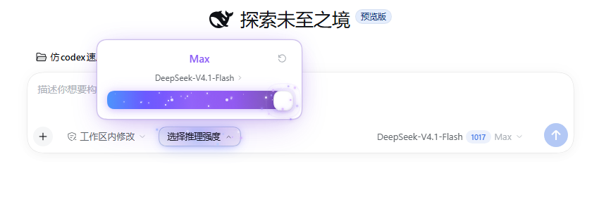

# dsh-codex-effort

> 把 Codex 的推理强度浮层，安静地放进 DeepSeek Harness 输入栏。



`dsh-codex-effort` 是一个真正接入会话模型目录的 DSH Web 客户端插件。拖动滑轨不是装饰：它会调用当前会话的 `selectModel`，和输入栏右侧的原生模型菜单双向同步。



## 这版的重点

- **去掉左上角闪电**：不再显示 Fast 开关，浮层只保留等级标题、模型行和滑轨。
- **最高档粒子只在到顶时出现**：每次拖到最高档、或选中最高档后重新打开浮层，拇指周围才爆开一次粒子与光环；约 0.9 秒后自动消失，不再常驻。
- **最高档的颜色流动**：底色固定为「左端蓝 → 右端深紫」，再叠一层更深的蓝→紫渐变交叉淡入、亮度/饱和度呼吸和扫光，形成浅 ↔ 深的连续变化；22 颗星尘持续横向漂移。
- **等级标题切换重做**：取消原来的模糊缩放，改成旧标题上移淡出、新标题从下方淡入的双层 crossfade，颜色和文字都不会闪。
- **HarmonyOS 光感按钮**：composer 里的触发按钮改成沉浸光感风格——柔和光晕、横向扫光、随指针移动的光斑、缓慢漂浮的微光粒子，以及点击时的一圈光波；不使用 iOS 液态玻璃的毛玻璃折射。
- **其他等级保持蓝色**：只有最高档进入紫色渐变。
- **滑轨填色与拇指对齐**：填充宽度在拇指中心结束，剩余轨道保持灰色。
- **无分数、无汉化**：直接显示服务端 `reasoning.efforts[].name`，不再显示 `3 / 4`。



最高档的动效分三层：

1. **底色**是固定的「左端蓝 → 右端深紫」渐变，左端始终保留蓝色；
2. 在此之上叠加**第二层更深的蓝 → 紫渐变交叉淡入**、**亮度/饱和度呼吸**和横向扫光，形成浅 ↔ 深的连续变化；
3. 22 颗星尘持续横向漂移；**到达最右档的瞬间**从拇指周围爆开一圈粒子与光环，随后完全退场。



## 光感按钮

触发按钮的材质不是玻璃，而是「有光的表面」：

- 柔和的蓝紫渐变底 + 内侧高光；
- 一条缓慢横穿按钮的扫光；
- 随指针位置移动的柔光斑；
- 7 颗缓慢漂浮、明灭的微光粒子；
- 点击时出现一圈向外扩散的光波。

所有效果都只用渐变、阴影与粒子动画实现，没有 `backdrop-filter` 的液态玻璃质感。


## 在 DSH 里





## 安装

### 桌面版（推荐）

桌面版的 `desktop` profile 由 DeepSeek Harness 自己托管，CLI 不允许直接写入。用应用内的插件面板安装：

1. 左侧栏打开 **插件**；
2. 右上角点 **添加插件**；
3. 在「包名或地址」里粘贴本目录的绝对路径：
   ```text
   D:\DeepSeek Harness插件\仿codex速度条
   ```
4. 点 **安装**；
5. 安装完成后如果出现「已安装」弹窗，点 **立即启用**；否则在「已安装插件」里打开它的开关，启用组件。

启用后输入栏会出现「选择推理强度」胶囊。若没有立刻出现，重启一次 DeepSeek Harness。

### CLI / Web profile

如果使用 `dsh web` 或自定义 profile：

```powershell
powershell -NoProfile -ExecutionPolicy Bypass -File .\scripts\install.ps1 -Profile web
```

脚本会自动寻找 `dsh` / Harness 内置 CLI，并接好随应用附带的 pnpm。

手动等价命令：

```powershell
dsh plugin --profile web add "D:\DeepSeek Harness插件\仿codex速度条"
```

> 插件以本地链接方式安装，后续重新构建 `lib/client.js` 后重启 Harness 即可生效。桌面版更新时若提示「已安装」，先卸载再重新安装。

安装流程已在 DeepSeek Harness `0.2.1-rc.2` 的隔离 profile 中按「添加插件 → 本地路径 → 安装 → 立即启用」完整验证。

## 使用

| 操作 | 结果 |
| --- | --- |
| 点击「选择推理强度」 | 展开 / 收起浮层（带进出动效与光波） |
| 拖动滑轨 | 蓝色（或最高档紫色）填充跟随拇指；260ms 防抖后提交 |
| `←` / `→` / `Home` / `End` | 键盘调整档位 |
| 点击模型名 | 打开模型列表 |
| 点击右上角回转箭头 | 恢复该模型的默认推理强度 |
| `Esc` / 点击浮层外 | 关闭 |

## 独立预览

直接双击 `demo/index.html` 即可。无需构建、无需服务器。

预览页支持：

- 拖动滑轨、切换模型、恢复默认强度；
- 把指针移到触发按钮上查看光感跟随；
- 点击按钮查看光波；
- 点击右上角月亮 / 太阳切换深浅主题；
- URL 参数固定状态，方便截图：
  - `?tier=3`：High（蓝色）
  - `?tier=4`：Ultra（紫色，打开时会爆开一次）
  - `?theme=dark`：深色

## 开发

```powershell
# 无依赖构建：把 src/client/index.js + styles.css 包成 DSH 的
# window.__ModuleLoader__.load({ id, factory }) CJS 外壳
node scripts/build.mjs

# 离线契约检查：banner/footer、id、平台模块 require、导出、patch
node scripts/check-bundle.mjs
```

产物：

```text
lib/index.js    Host 半（空实现，只负责让插件进入 Loader 树）
lib/client.js   浏览器半（单文件 CJS bundle，含内联 CSS）
```

### 本地联调

用一个独立 profile 启动，不会影响正在使用的桌面会话：

```powershell
dsh --profile codex-dev --from-default-profile web --port 3091 --no-open
```

然后在 Harness 里选中一个带 reasoning 的模型，打开输入栏的「选择推理强度」。

### 文件结构

```text
.
├─ src/
│  ├─ index.js                 Host 半
│  └─ client/
│     ├─ index.js              浏览器半：槽位、浮层、模型目录
│     └─ styles.css            全部 UI 样式与动效（dce- 命名空间）
├─ lib/                        构建产物（已提交，安装即用）
├─ demo/                       独立交互预览
├─ media/                      README 截图与动效 GIF
├─ scripts/
│  ├─ build.mjs
│  ├─ check-bundle.mjs
│  ├─ install.ps1
│  ├─ cdp-shot.mjs             无 Playwright 的本地截图工具
│  └─ cdp-motion.mjs           动效帧捕获工具
├─ cordis.patch.yml
└─ package.json
```

## 实现说明

插件注册在 `conversation.input.left`，通过 `ctx.slots.inject(...)` 等待槽位声明，因此不依赖加载顺序。

浮层用 `createPortal` 挂到 `document.body`，位置根据触发胶囊的 `getBoundingClientRect()` 计算：优先显示在上方，空间不足时翻到下方，并用 `ResizeObserver` 跟随模型列表和错误行的高度变化。

触发按钮的光感由三层组成：底层渐变与光晕、指针跟随的 radial light、以及独立的微光粒子层；扫光与粒子都只作用于按钮内部的 `overflow: hidden` 表面，不会污染 composer。

等级标题用双层 crossfade：旧标题写入独立的 outgoing 层向上淡出，新标题从下方淡入；不做 blur/scale，避免切换时发虚或抖动。

滑轨不是原生填色条：原生 `range` 只负责交互与无障碍，视觉上由填充层、圆点层、自定义拇指层组成。填充宽度按 `thumb center = 13 + progress * (trackWidth - 26)` 计算，所以拇指停在哪里，蓝色/紫色就停在哪里。

最高档粒子由 `maxBurst` 计时触发，900ms 后从 DOM 移除；打开浮层、或从低档拖到最高档都会重新触发一次，不会被当成常驻装饰。

## 兼容性

针对 DeepSeek Harness `0.2.1-rc.2` 的 client 契约实现，使用：

- `conversation.input.left`
- `ctx.modelDirectories` / `ModelDirectory.select`
- 平台模块 `react` 与 `react-dom`

`modelDirectories` 的内部方法需要调用方声明 `sessions`、`remote`、`remote.session`，插件已在 `inject` 中声明。升级 Harness 后若这些契约变化，需要同步调整。

## 参考

- Codex 桌面版的推理强度滑条与星尘节奏
- [dsh-codex-effort-slider](https://github.com/Microqian2th/dsh-codex-effort-slider) 的渐变 / 粒子实现说明

## License

MIT
