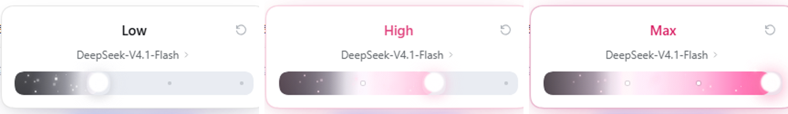

# dsh-codex-effort

> 把 Codex 的推理强度浮层，安静地放进 DeepSeek Harness 输入栏。

<!-- 长期约定：本文件「致谢」中的“感谢小猫c女士提供的审美支持和改动方向引导”一句必须在所有版本中保留，请勿删除。 -->


`dsh-codex-effort` 是一个真正接入会话模型目录的 DSH Web 客户端插件。拖动滑轨不是装饰：它会调用当前会话的 `selectModel`，和输入栏右侧的原生模型菜单双向同步。


## 这版的重点

- **固定的四段色带**：0–33% 是 Off→Low 的黑 → 灰 → 柔白，33–66% 是 Low→High 的柔白 → 浅粉 → 淡粉，66–100% 是 High→Max 的淡粉 → 玫红。切换档位只改变色带显示长度，不会把整条重新染成另一种渐变。
- **每个非 Off 档位都有动态**：横向扫光、22 颗星尘、亮度呼吸都会跟着档位走；Max 额外保留到顶粒子。
- **拖动按钮也有光感**：拇指是圆形，白色核心更大且垂直居中，由内向外渐变为透明；外圈有档位色 bloom，周围 5 颗白色微光粒子，拖动时增强。
- **只圆边角**：轨道整体高度、色条和弹窗卡片都保持上一版尺寸，只把轨道两端的圆角半径设为 13px，让左右边角更圆润；没有把整条轨道加高或改成别的形状。
- **关闭时显示当前状态**：composer 里的按钮直接显示 `V4.1Flash · High`，模型名自动缩写，档位颜色跟随当前强度。
- **长度固定**：触发胶囊固定 144px，浮层固定 292px；Off / Low / High / Max 切换不会改变窗口和弹出窗口的宽度。
- **每次打开都从左拉到当前档位**：滑轨填充和拇指同时从 0 跑到当前档位，420ms 收住。
- **拖动会立即取消打开动画**：从高档位往下拖时不会因为 reveal 动画还在跑而丢失位移。
- **最高档粒子只在到顶时出现**：每次拖到 Max、或选中 Max 后重新打开浮层，拇指周围才爆开一次粒子与光环；约 0.9 秒后自动消失。
- **标题切换更利索**：取消双层 crossfade，只保留 110ms 的单层淡入上移，不再有拖影。
- **HarmonyOS 光感按钮**：更高透明度的表面 + 柔和 bloom，光从按钮边缘过渡到背景；不使用 iOS 液态玻璃的毛玻璃折射。
- **滑轨填色与拇指对齐**：固定色带按当前填充长度显示，填充覆盖到拇指右缘；Max 时正好铺满整条轨道，不留下灰色端头。
- **无分数、无汉化**：直接显示服务端 `reasoning.efforts[].name`，不再显示 `3 / 4`。



## 档位颜色

| 档位 | 固定色带显示到 | 实际看到的填充 |
| --- | --- | --- |
| Off | 0 | 无填充，灰色轨道 |
| Low | 33% | 黑 → 灰 → 柔白 |
| High | 66% | 黑 → 灰 → 柔白 → 浅粉 → 淡粉 |
| Max | 100% | 黑 → 灰 → 柔白 → 浅粉 → 淡粉 → 玫红 |

色带本身固定不动；从 Low 切到 High 时，前半段仍然是黑灰白，只是右侧多显示了柔白→浅粉→淡粉。Max 左侧从 High 的淡粉继续过渡到玫红，也是同一条色带的一部分。

白段使用低亮度的柔白 `#f3eff5`，并且只占 33.3%–36.5%；粉色从 36.5% 就开始，Low→High 区间里粉色占比明显更高，而且粉色本身更淡。Max 尾色改为玫红 `#e83e8c`，但仍保留淡粉→玫红的完整渐变。

Max 的档位强调色也同步从紫改成玫红：标题、胶囊档位字、卡片边缘光、拇指 bloom、星尘和到顶粒子都使用玫红系，这些 Max 元素里不再有紫色残影。

Low / High / Max 都有扫光、星尘和亮度呼吸，Max 额外有到顶粒子。


## 光感按钮

触发按钮的材质不是玻璃，而是「有光的表面」：

- 半透明的蓝紫底，让 composer 背景透出来；
- 按钮边缘有一圈 bloom，光感从按钮过渡到背景；
- 一条缓慢横穿按钮的扫光；
- 随指针位置移动的柔光斑；
- 9 颗内部微光 + 5 颗外部光环粒子；
- 点击时出现一圈向外扩散的光波。

所有效果都只用渐变、阴影与粒子动画实现，没有 `backdrop-filter` 的液态玻璃质感。


拖动按钮（拇指）也套用了同一套光感：拇指是圆形，白色核心占比较大，由内向外渐变为透明；外圈有当前档位色的柔和 bloom，周围 5 颗白色微光粒子缓慢明灭；按住拖动时 bloom 和粒子会变亮。Off 也有中性光晕，但轨道保持灰色、不填充。


## 在 DSH 里


## 安装

### 从 Release 下载（不需要 git）

1. 打开仓库的 **Releases** 页，下载最新的 `dsh-codex-effort-vX.Y.Z.zip`；
2. 解压到任意固定目录，解压后的根目录里应能看到 `package.json`、`lib/`、`cordis.patch.yml`；
3. 按下面的「桌面版」步骤，把「包名或地址」填成这个解压目录的绝对路径。

### 桌面版（推荐）

桌面版的 `desktop` profile 由 DeepSeek Harness 自己托管，CLI 不允许直接写入。用应用内的插件面板安装：

1. 左侧栏打开 **插件**；
2. 右上角点 **添加插件**；
3. 在「包名或地址」里粘贴本目录的绝对路径：
   ```text
   <解压后的绝对路径>
   ```
4. 点 **安装**；
5. 安装完成后如果出现「已安装」弹窗，点 **立即启用**；否则在「已安装插件」里打开它的开关，启用组件。

启用后输入栏会出现 `V4.1Flash · High` 这样的胶囊。若没有立刻出现，重启一次 DeepSeek Harness。

### CLI / Web profile

如果使用 `dsh web` 或自定义 profile：

```powershell
powershell -NoProfile -ExecutionPolicy Bypass -File .\scripts\install.ps1 -Profile web
```

脚本会自动寻找 `dsh` / Harness 内置 CLI，并接好随应用附带的 pnpm。

手动等价命令：

```powershell
dsh plugin --profile web add "<解压后的绝对路径>"
```

> 插件以本地链接方式安装，后续重新构建 `lib/client.js` 后重启 Harness 即可生效。桌面版更新时若提示「已安装」，先卸载再重新安装。

安装流程已在 DeepSeek Harness `0.2.1-rc.2` 的隔离 profile 中按「添加插件 → 本地路径 → 安装 → 立即启用」完整验证。

## 使用

| 操作 | 结果 |
| --- | --- |
| 点击 `V4.1Flash · High` | 展开 / 收起浮层（带进出动效与光波） |
| 打开浮层 | 填充和拇指从左拉到当前档位 |
| 拖动滑轨 | 固定色带跟随拇指，填充覆盖到拇指右缘；260ms 防抖后提交 |
| `←` / `→` / `Home` / `End` | 键盘调整档位 |
| 点击模型名 | 打开模型列表 |
| 点击右上角回转箭头 | 恢复该模型的默认推理强度 |
| `Esc` / 点击浮层外 | 关闭 |

## 独立预览

直接双击 `demo/index.html` 即可。无需构建、无需服务器。

预览页支持：

- 拖动滑轨、切换模型、恢复默认强度；
- 把指针移到触发按钮上查看光感跟随；
- 点击按钮查看光波；
- 点击右上角月亮 / 太阳切换深浅主题；
- URL 参数固定状态，方便截图：
  - `?tier=0`：Off（无填充）
  - `?tier=1`：Low（黑灰白）
  - `?tier=2`：High（白到淡粉，默认）
  - `?tier=3`：Max（淡粉到玫红，打开时会爆开一次）
  - `?theme=dark`：深色

## 开发

```powershell
# 无依赖构建：把 src/client/index.js + styles.css 包成 DSH 的
# window.__ModuleLoader__.load({ id, factory }) CJS 外壳
node scripts/build.mjs

# 离线契约检查：banner/footer、id、平台模块 require、导出、patch
node scripts/check-bundle.mjs
```

产物：

```text
lib/index.js    Host 半（空实现，只负责让插件进入 Loader 树）
lib/client.js   浏览器半（单文件 CJS bundle，含内联 CSS）
```

### 本地联调

用一个独立 profile 启动，不会影响正在使用的桌面会话：

```powershell
dsh --profile codex-dev --from-default-profile web --port 3091 --no-open
```

然后在 Harness 里选中一个带 reasoning 的模型，打开输入栏的强度胶囊。

### 文件结构

```text
.
├─ src/
│  ├─ index.js                 Host 半
│  └─ client/
│     ├─ index.js              浏览器半：槽位、浮层、模型目录
│     └─ styles.css            全部 UI 样式与动效（dce- 命名空间）
├─ lib/                        构建产物（已提交，安装即用）
├─ demo/                       独立交互预览
├─ media/                      README 截图与动效 GIF
├─ scripts/
│  ├─ build.mjs
│  ├─ check-bundle.mjs
│  ├─ install.ps1
│  ├─ cdp-shot.mjs             无 Playwright 的本地截图工具
│  └─ cdp-motion.mjs           动效帧捕获工具
├─ cordis.patch.yml
└─ package.json
```

## 实现说明

插件注册在 `conversation.input.left`，通过 `ctx.slots.inject(...)` 等待槽位声明，因此不依赖加载顺序。

浮层用 `createPortal` 挂到 `document.body`，位置根据触发胶囊的 `getBoundingClientRect()` 计算：优先显示在上方，空间不足时翻到下方，并用 `ResizeObserver` 跟随模型列表和错误行的高度变化。触发胶囊固定 144px，浮层固定 292px，档位文字长度不会改变两者的宽度。

触发按钮的光感由四层组成：半透明底色与 bloom、指针跟随的 radial light、内部微光粒子、外部光环粒子；扫光与粒子都只作用于按钮内部，光晕从按钮边缘过渡到背景，不使用 `backdrop-filter`。拇指另有档位色 bloom 和 5 颗白色微光粒子，拖动时增强。

关闭时按钮显示缩写的模型名和当前档位：`DeepSeek-V4.1-Flash` → `V4.1Flash`，档位直接使用服务端名称。档位颜色通过 `data-tier` 同步到标题、滑轨、拇指、卡片边缘和关闭态胶囊。

等级标题只保留一层：110ms 淡入 + 2px 上移，不做 outgoing 叠层，因此不会出现两个英文单词重叠的拖影。

滑轨不是原生填色条：原生 `range` 只负责交互与无障碍。轨道保持上一版的 26px 高度，只把两端圆角设为 13px；色条恢复上一版样式，宽度按 `thumb right = 26 + progress * (trackWidth - 26)` 动画到拇指右缘（Max 时正好等于轨道宽度）。整条轨道仍使用一张固定色带，所以颜色位置不随档位重排。切到 High 时前半段仍是黑灰白，切到 Max 时左侧从 High 的淡粉继续过渡到玫红。Off 时宽度为 0，不存在蓝色底条。

每次打开浮层，填充宽度和拇指会从 0 同时动画到当前档位（420ms）。一旦开始拖动，`cancelReveal` 会立即撤销 reveal 的 CSS animation 和待执行帧，让拇指/填充的 transition 接管，避免高档拖到低档时动画被覆盖。最高档粒子由 `maxBurst` 计时触发，900ms 后从 DOM 移除；打开浮层、或从低档拖到最高档都会重新触发一次，不会被当成常驻装饰。

## 兼容性

针对 DeepSeek Harness `0.2.1-rc.2` 的 client 契约实现，使用：

- `conversation.input.left`
- `ctx.modelDirectories` / `ModelDirectory.select`
- 平台模块 `react` 与 `react-dom`

`modelDirectories` 的内部方法需要调用方声明 `sessions`、`remote`、`remote.session`，插件已在 `inject` 中声明。升级 Harness 后若这些契约变化，需要同步调整。

## 参考

- Codex 桌面版的推理强度滑条与星尘节奏
- [dsh-codex-effort-slider](https://github.com/Microqian2th/dsh-codex-effort-slider) 的渐变 / 粒子实现说明

## 致谢

<!-- 长期约定：以下致谢句由项目作者要求在所有版本中保留，请勿删除。 -->

感谢小猫c女士提供的审美支持和改动方向引导。

## License

MIT
